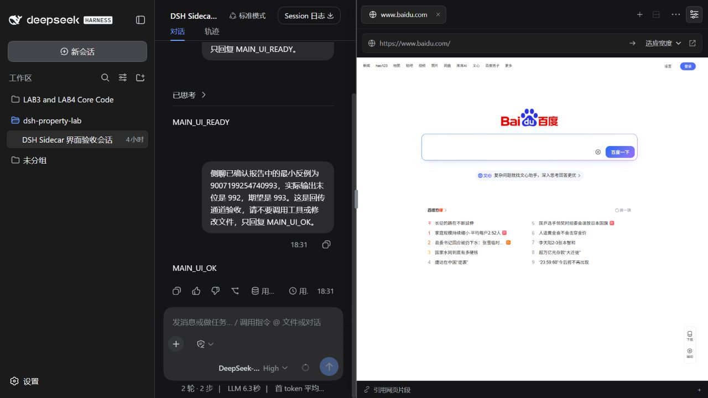

# DSH Sidecar

[](https://github.com/wangyili-1/dsh-sidecar/actions/workflows/test.yml)
[](LICENSE)

Browser tabs, independent side chats, and resizable split panes for **DeepSeek Harness**.

[中文](README.md) · **English** · [Quick start](#quick-start) · [Latest release](https://github.com/wangyili-1/dsh-sidecar/releases/latest) · [Report an issue](https://github.com/wangyili-1/dsh-sidecar/issues)

Keep your main task running while you inspect a webpage, discuss an error separately, and review a conclusion before sending it back. This independently developed plugin uses DSH's native Web client, authenticated connection, and model configuration; it stores no separate model API key.



This screenshot comes from the actual DSH interface. Opening the sidebar makes room in the main layout; it does not cover the main input box.

## Quick start

You need **Git**, **Node.js 22+**, and **DeepSeek Harness 0.1.2-rc.1** with a working model configuration. Other DSH versions are not supported by this release. Application checks used Windows 11 and Node.js 24.11.1; see the [validation record](VALIDATION.md) for the tested scope.

Clone into a location where you intend to keep the plugin:

```powershell
git clone https://github.com/wangyili-1/dsh-sidecar.git
cd dsh-sidecar
npm ci
npm run build
npm run doctor
npm run install:dsh -- --workspace "C:\path\to\your-project"
```

**Replace `C:\path\to\your-project` with your workspace path.** Installation backs up and updates DSH's existing `web` profile. Keep the checkout in place afterward: DSH loads the plugin from its absolute path.

If DSH is running, **save drafts, stop tasks, exit the DSH service, and restart it with your usual launcher**. Closing only the browser window may leave the service running. Your existing shortcut can still be used if it launches the same DSH home and `web` profile.

Select a workspace, then use DSH's upper-right menu and sidebar toggle. The tab bar's **＋** adds webpages and side chats. Opening the panel does not automatically call a model.

For custom DSH locations, release archives, standalone launch, and upgrade instructions, see the [full installation guide in Chinese](README.md#安装到现有-dsh).

## What you can do

- **Browser-style tabs:** switch, reorder, close, and reopen webpages and chats within the current page and main conversation.
- **Resizable split panes:** drag a tab downward to split, resize the divider, or merge again. Drag the sidebar's left edge to adjust its width while the main layout follows.
- **Independent side chats:** separate sessions, drafts, references, and send/stop actions. Stopping a side chat leaves the main task running.
- **Reviewed references and handoffs:** add workspace text files or pasted text through the input's ＋ menu. Review references before sending; edit a conclusion before explicitly queuing it in the main conversation.
- **Native chat controls:** permissions, models, reasoning levels, context usage, and statistics for the selected side chat. As in DSH, changing its model also sets the default for future sessions.
- **Webpage sizing:** fit-to-width, 100% with horizontal scrolling, or responsive layout; page instances stay mounted when switching or rearranging panes.
- **Chat organization:** local titles from the first explicit question. Closing a tab is temporary; removing a stopped chat from the continuation list persists and archives its original DSH history.

## Limits to know

- **The workspace is shared.** Independent sessions isolate messages and cancellation, not the filesystem. DSH still controls model tool permissions. Asking a side chat to analyze only the supplied material is a behavioral instruction, not a filesystem sandbox.
- **Unsent content is page-local.** A full page refresh, reopening the window, or switching the main conversation resets tab layout, webpage state, unsent drafts, and pending references. DSH retains sent chat history. Hiding the sidebar or temporarily closing and reopening a tab within the same page preserves its cached content.
- **Websites control whether they can be embedded.** Some pages or features will not work inside the sandboxed preview. Open those sites externally. Sidecar does not read cross-origin iframe contents; webpage quotations use text you explicitly paste.
- **Titles are not model-generated summaries.** They use the first readable user question and exclude system/reference wrappers. A chat without a question or recoverable history keeps the untitled label.

## Development and documentation

Check a source change with:

```powershell
npm test
npm run build
npm pack
```

Ordinary tests and builds do not call a model. [Validation details](VALIDATION.md) distinguish automated tests from actual DSH checks; remote results are in [GitHub Actions](https://github.com/wangyili-1/dsh-sidecar/actions/workflows/test.yml).

- [Complete Chinese documentation](README.md)
- [Release downloads](https://github.com/wangyili-1/dsh-sidecar/releases/latest) and [changelog](CHANGELOG.md)
- [Validation details and real screenshots](VALIDATION.md)
- [MIT license](LICENSE)

This is an independent DSH plugin, not an official DeepSeek or OpenAI product. It contains no Codex interface code or assets. Its integration targets the [DSH 0.1.2-rc.1 source](https://github.com/deepseek-ai/deepseek-harness/tree/dsh-v0.1.2-rc.1).
