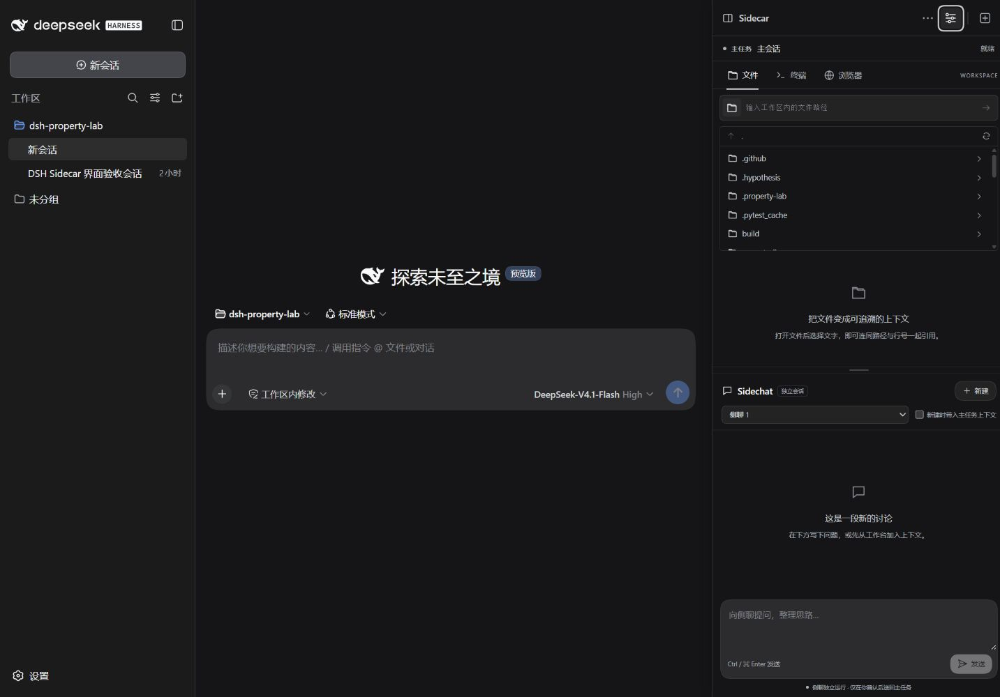

# dsh-sidecar

为 **DeepSeek Harness 0.1.2-rc.1** 增加独立侧聊和文件、命令、网页工作面板。主任务继续执行，你可以在旁边解释报错、查看代码、核对反例，再选择将结论送回主任务。

这是原生 DSH 前后端插件：通过现有的身份认证连接和 Session Controller 工作，不另存 API Key，不替换 DSH 的模型运行器。**v0.2.1** 支持安装到现有 DSH Web 配置，在原来的桌面快捷方式打开的界面中提供右上角工具栏和联动收缩的侧栏。当前针对固定版本适配，尚不支持将插件直接放入任意新版 DSH。



侧栏展开时，主页面同步收窄并居中；收起后恢复原宽度。上图来自真实 DSH 空白首页，普通会话效果见 [截图](docs/docked-conversation.jpg)，测试范围见 [验证记录](VALIDATION.md)。

## 功能

- **原生黑灰界面**：复用 DSH 的主题变量、字体和输入框层级，使用灰阶按钮与细边框。
- **侧栏与主页面联动**：复用 DSH 的 0.3 秒缓动，侧栏滑入的同时预留实际布局宽度，不遮挡主输入框。收起保留侧聊草稿；系统设置减少动态效果时关闭过渡。
- **右上角插件入口**：功能菜单直接打开文件、命令、网页或侧聊；旁边的按钮切换侧栏、创建新的侧聊。选好工作区后，尚未发送消息的首页也能使用。
- **独立侧聊**：与选中的主会话关联，使用不同 Session ID。主任务和侧聊分别发送、停止、保存；关闭面板后恢复 DSH 原有工具详情。
- **文件面板**：浏览当前工作区的文本文件，显示行号，把所选片段加入可审阅的上下文引用。识别 Property Lab JSON 报告的反例及搜索结果。
- **命令面板**：手动运行命令，查看输出和退出码，停止自己的命令，并将选中输出附到侧聊。它是非 PTY 的命令台，每条命令从工作区启动；不支持交互密码、全屏 TUI 或跨命令保留 `cd`。
- **网页面板**：显示 HTTP(S) 网页和本地开发页面。通过 URL 和显式粘贴的片段引用网页；不假装能从跨域 iframe 自动读取任意内容。
- **回传主任务**：先查看并编辑结论，再明确发送到主会话队列；不会自动把全部旁聊塞进主任务。

侧聊和主任务共享工作区，隔离的是会话状态、消息路由及取消操作，不是复制出两个文件系统。侧聊默认被要求只分析引用内容；这属于行为约定，模型工具权限仍由 DSH 管理。

## 安装到现有 DSH

需要 Node.js 22 或更高版本，以及已配置好模型的 DSH **0.1.2-rc.1**。先进入本项目目录：

```powershell
npm install
npm run build
npm run doctor
npm run install:dsh -- --workspace "C:\path\to\your-project"
```

然后重新打开原来的 **DeepSeek Harness** 桌面快捷方式。首页右上角有三个入口：

| 按钮 | 操作 |
| --- | --- |
| `···` 功能菜单 | 直接切换到文件、命令、网页或侧聊 |
| 调节图标 | 展开或收起侧栏 |
| 方框加号 | 创建并打开新的侧聊，不向主会话发送消息 |

面板上半区域是文件、命令和网页，下半区域是独立侧聊。先在 DSH 中选择工作区；当前主会话还没有消息时也能打开面板。如果当前没有主会话，插件会为所选工作区连接一个空会话，不自动调用模型。

安装器向 DSH 的 Web profile（默认 `~/.dsh/profiles/web/cordis.patch.yml`）添加一个插件条目，修改前保存原文件备份。重复安装相同路径不会重复添加，也不会覆盖已有 Sidecar 设置。插件以本项目的绝对路径加载，**安装后请保留项目目录的位置**；迁移目录时先卸载，再从新目录安装。

此方式不修改桌面快捷方式或 DSH 安装程序。本机的 DeepSeek Harness 快捷方式由第三方 Whale Girl 启动器打开官方 DSH Web 运行时；它并不是 DSH 官方桌面客户端。其他启动器只要使用同一 DSH home 和 `web` profile，也能加载该条目。

查看安装状态或卸载：

```powershell
npm run status:dsh
npm run uninstall:dsh
```

卸载只移除 Sidecar 的插件条目及针对它的覆盖项，保留其他 profile 配置；卸载前同样保存备份。随后重新打开 DSH。安装、状态和卸载命令均支持 `--dsh-home "PATH/TO/.dsh"`，安装另支持 `--dsh-cli "PATH/TO/@deepseek-ai/dsh/lib/bin.js"`。

## 单独启动（可选）

也可另起本机 DSH Web 实例用于调试，默认地址为 `http://127.0.0.1:3082`：

```powershell
npm start -- --workspace "C:\path\to\your-project" --open
```

启动器复用已有模型配置。已经安装到 Web profile 时直接使用该插件条目，避免重复加载；尚未安装时使用一次性的插件配置覆盖层。若 profile 中相同插件 ID 指向其他目录，启动器会报告冲突，请先从旧目录卸载。

Windows 完成首次安装和构建后，可以双击 `Start-Sidecar.cmd`。也可指定工作区：

```powershell
.\Start-Sidecar.cmd "C:\path\to\your-project"
```

启动窗口保持打开即可；关闭窗口或 Ctrl+C 会停止本实例。命令参数决定默认工作目录，在 DSH 界面仍需选择对应工作区和主会话。

若未自动找到 DSH，显式指定安装路径：

```powershell
npm start -- --dsh-cli "PATH/TO/@deepseek-ai/dsh/lib/bin.js" --workspace "PATH/TO/project" --open
```

`DSH_SIDECAR_CLI` 也可指定同一路径。`--port 4092` 可更换端口；端口占用时启动器会报错，不会终止其他进程。保留终端运行，按 Ctrl+C 停止本实例。

## 引用与持久化

引用内容会显示来源，可在发送前查看和移除；只在你发送时进入对应对话。主会话上下文取已完成的消息摘录，不把仍在执行的工具调用复制成新会话的可执行历史。

侧聊关联数据写入 `.local/state/`，实际聊天历史由 DSH 保存。`.local/`、运行日志和依赖目录均被 Git 忽略。命令输出只在本次服务进程内保留；浏览器是否允许嵌入由目标网站决定，拒绝嵌入时应在外部浏览器打开。

文件读取限制在选中主会话的工作区，检查真实路径以阻止目录穿越与链接逃逸，并限制文件及输出大小。命令台只在你明确运行命令时执行，使用本机当前用户权限，不注册为模型工具。DSH 会话内的模型工具仍遵循 DSH 自身的权限策略。

## 开发与验证

```powershell
npm test
npm run build
npm pack
```

`src/host.mjs` 注册已认证 RPC；`src/service.mjs` 管理会话、文件和命令；`src/client.jsx` 接入原生槽位；`src/Panel.jsx` 是面板界面。构建复用 DSH 提供的 React，不打包第二份 React。

真实执行结果、已测试范围与限制记录在 [VALIDATION.md](VALIDATION.md)。独立测试会话与本地日志不作为源码发布。

已在真实 DSH 中验证主任务与侧聊同时运行、单独停止侧聊及主任务继续完成，7 项检查全部通过；保留脱敏的 [执行记录](docs/acceptance.json)。属性测试报告中的大整数直接从 JSON 原文提取，避免把 `9007199254740993` 显示成另一个数。

## 许可

[MIT](LICENSE)。这是独立实现的 DSH 插件，不包含 Codex 的界面代码或资源。DSH 的接口与版本边界见 [固定版本的官方源码](https://github.com/deepseek-ai/deepseek-harness/tree/dsh-v0.1.2-rc.1)。
