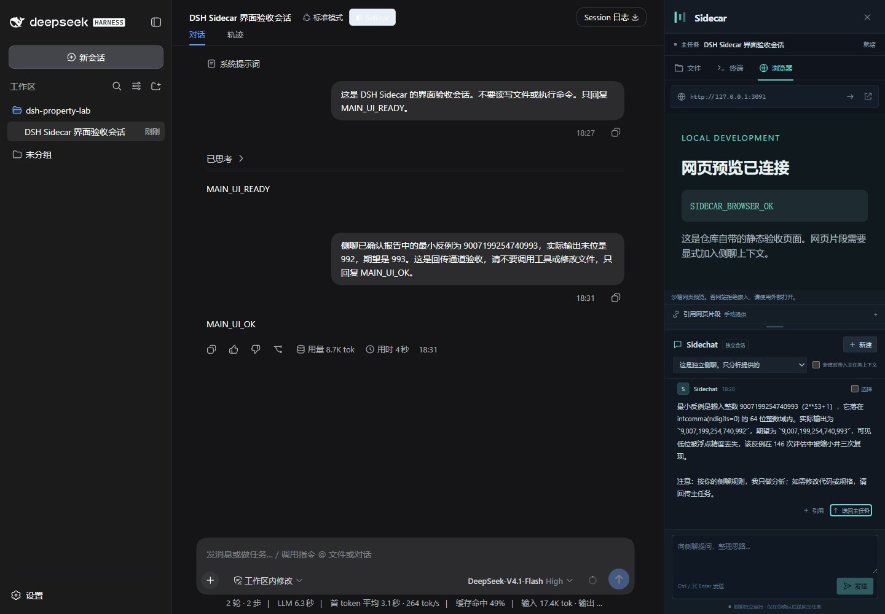

# 验证记录

日期：2026-10-25（Asia/Shanghai）。本地 Windows 11、Node.js 24.11.1、DeepSeek Harness 0.1.2-rc.1；DSH 官方固定版本源码提交为 `a66e4702047846cdaa10c66c9d3df3951f5ea70d`。运行原生 Web 客户端插件，使用 DSH 已有的认证连接及模型配置。

## v0.3.0 顶部标签与上下分屏

在原桌面快捷方式使用的同一个 `127.0.0.1:3080` 服务中加载新版插件，实际操作通过：

- 将“终端”标签从顶栏拖到内容区下半部，形成上方文件、下方终端，分隔条初始值为 50；合并后再拖动，将顺序从“文件、终端”改为“终端、文件”。
- 打开两个独立网页，分别输入不同便签。切换、上下分屏、合并、关闭并恢复后，页面输入仍然保留。分隔条按 ArrowDown 后从 50 调整为 55。
- 打开已有侧聊并新建一个空白侧聊，输入不同的未发送草稿；两段侧聊分屏显示时草稿相互独立。关闭并恢复第二段侧聊后草稿仍在，验收结束已清空两份测试草稿，没有发送模型消息。
- 关闭下方最后一个标签后自动合并；通过“＋”菜单恢复关闭的标签。最终页面控制台没有捕获到 error 级别日志。

截图为真实 DSH 页面：[网页与侧聊](docs/tabbed-workspace.jpg)、[两个网页](docs/two-webpages.jpg)。页面 A/B 是本地验收夹具，由 [tab-preview-server.mjs](docs/tab-preview-server.mjs) 提供；截图中的模型消息是此前验收的历史消息。本次没有重跑模型并发测试。结构化观察见 [tabs-acceptance.json](docs/tabs-acceptance.json)。

拖动的实机验收使用终端标签；带 iframe 网页的坐标自动化受工具限制，网页状态保留通过实际分屏、合并和恢复按钮验证，不宣称已完成网页标签跨 iframe 的物理拖动验收。标签布局、未发送草稿和网页状态在当前页面及主会话内缓存，刷新页面或切换主会话后不恢复；已保存的侧聊历史继续由 DSH 管理。

## v0.2.1 侧栏布局与动画

修复用户反馈的空白首页遮挡问题：在 1440 × 1000 的真实 DSH 页面中，修复前主输入框右边界为 1239.20 px、侧栏左边界为 1020 px，覆盖约 219.20 px。修复后主输入框右边界为 992 px，侧栏左边界仍为 1020 px，覆盖为 0；关闭侧栏后输入框恢复原来的 1239.20 px。

实际点击展开、收起并读取过渡中的布局值：收起时主区域仍有 416.33 px 预留，侧栏已右移 3.81 px；展开时预留从 1.56 px 开始增加，侧栏从右侧滑入。两者复用 DSH 的 0.3 秒动画与 `cubic-bezier(.4, 0, .2, 1)`；结束后收起面板为 hidden/inert，不能抢占输入焦点。

普通会话由 DSH 原生详情列预留 360 px，插件补足 60 px，合计 420 px，没有双重挤压。在 900 × 800 窗口中，主输入框宽度为 380 px、右边界为 452 px，侧栏左边界为 480 px，仍无重叠。上述数字是布局 DOM 的实测值，记录在 [layout-acceptance.json](docs/layout-acceptance.json)。

另已实机检查：关闭再打开保留未发送草稿（验收后已清空）；功能菜单可切换文件、终端、网页；文件面板读取真实 humanize 反例报告；页面控制台没有错误。本次没有发送模型消息，也没有重新执行并发模型验收或新建侧聊的点击验收。截图：[空白首页](docs/docked-home.jpg)、[普通会话](docs/docked-conversation.jpg)。

## v0.2 桌面快捷方式集成（历史记录）

本次将插件安装到原桌面 **DeepSeek Harness** 快捷方式使用的 `web` profile，未修改快捷方式目标。安装状态检查确认只有一个 `dsh-sidecar` 条目，启动器诊断确认使用 `profile` 模式，不重复添加临时插件。安装前已备份 profile 原文件。

通过原快捷方式对应的启动器启动本机 `127.0.0.1:3080`，在同一服务的真实 Web 客户端中观察到空白首页的三个控件：`Sidecar 功能菜单`、`打开 Sidecar 侧栏`、`新建 Sidecar 侧聊`。页面仍为未发送消息的“新会话”，工作区为 dsh-property-lab。桌面窗口列表也确认已打开标题为 DeepSeek Harness 的 Edge 独立窗口。

此次同时修复本机第三方 Whale Girl 启动器：PowerShell 子进程已经退出、DSH 服务健康，但启动画面被无超时的输出管道等待卡住。删除输出重定向和无超时等待，保留 75 秒等待、退出码与服务健康检查；源码和可执行文件已在原目录备份为 `*.before-pipe-fix-20261025-210838`。重新编译版本为 3.1.0.2，实际恢复到浏览器选择及打开独立窗口。尚未再次停止服务重测冷启动。

**验收范围限制：**随后 Windows 桌面自动化因无法可靠确认当前浏览器网址而停止。已确认新版首页入口加载，尚未完成新版菜单、开关和新建侧聊的逐项实机点击，也未拍摄新版截图。下方模型调用与截图属于此前 v0.1 功能验收，不能视作新版工具栏点击结果。新增行为通过本节后列出的自动化测试验证。

## v0.1 真实并发与取消

通过已安装 DSH 的 Session Controller 创建专用主、侧会话并进行真实模型调用。主任务执行短暂等待，侧聊同时回复；随后再次启动主任务和侧聊，只取消侧聊。

| 检查 | 结果 |
| --- | --- |
| 主、侧会话使用不同 ID | 通过 |
| 收到 `SIDE_DONE` 时主任务仍运行 | 通过 |
| 主任务随后完成并回复 `MAIN_DONE_A` | 通过 |
| 停止侧聊前主任务仍运行 | 通过 |
| 停止侧聊后主任务仍运行 | 通过 |
| 被指定的侧聊停止 | 通过 |
| 主任务最终完成并回复 `MAIN_DONE_B` | 通过 |

这次运行开始于 18:15:54，结束于 18:16:38。脱敏后的时间、检查和公开回复保存在 [acceptance.json](docs/acceptance.json)，不含凭据、请求头或模型推理。该记录验证会话运行与取消隔离，不宣称是文件系统隔离。

## v0.1 真实界面操作

在原生 DSH 中新建“DSH Sidecar 界面验收会话”，使用其真实文件和模型接口：

- 点击标题栏 Sidecar 后打开工作台；关闭后恢复原有工具详情。
- 文件面板读取 dsh-property-lab 的 humanize 原始报告，正确显示反例 `9007199254740993`，评估次数 146。
- 将报告加入上下文包并发送。侧聊实际回复中包含正确的输入、实际值 `9,007,199,254,740,992` 和期望值 `9,007,199,254,740,993`。
- 手动运行 `Write-Output 'SIDECAR_TERMINAL_OK 中文'`，获得完整中英文输出，退出码为 0。
- 在沙箱 iframe 中打开本机 HTTP 静态页面，显示 `SIDECAR_BROWSER_OK`。测试页面源码为 [preview.html](docs/preview.html)。
- 打开“送回主任务”预览，编辑内容并确认排队；原主会话收到补充并回复 `MAIN_UI_OK`。



上图保留初次功能验收时的样式。随后在 v0.1 中将界面调整为 DSH 原生黑灰风格，复用 `--dsw-*` 主题变量；实际检查了文件、命令、侧聊及回传预览，浏览器控制台无错误。当时的外观见 [主界面](docs/sidecar-demo.jpg) 和 [回传弹窗](docs/neutral-dialog.jpg)。v0.2 延续黑灰样式并替换入口，这两张图仍为此前记录。外观调整和本次入口集成均未再次调用模型执行并发验收。

截图来自实际运行的 DSH，验收时设置桌面视口以完整呈现双栏；没有使用生成式图片或模拟聊天替换结果。

## 自动化覆盖

v0.3.0 最终 `npm test`：**77 项通过，0 失败、0 跳过**，用时约 2.52 秒。本次新增 19 项测试，覆盖标签排序与跨组移动、关闭恢复、500 次混合操作的不变量、指针捕获拖动、Surface 身份与生命周期、两段侧聊的草稿及请求隔离、独立网页状态和上下文引用路由。原有 58 项继续覆盖布局预留、响应式空间、原生详情栏恢复、工作区连接及异步导航竞争、StrictMode 下新建侧聊只执行一次、安装备份与幂等、卸载保留其他配置、RPC 错误与取消信号、会话所有权、路径限制、命令输出及大整数反例。

`npm run build` 生成可加载的 Host 和 Web 客户端包；打包清单排除 `.local/`、运行日志、凭据和 node_modules。GitHub Actions 已提供 Windows/Linux × Node 22/24 的配置，尚未发布此仓库，因此不宣称远端 CI 已执行。

Windows 的 `Start-Sidecar.cmd -Doctor` 实际运行通过，自动找到已安装的 Node 和 DSH，退出码为 0。启动脚本只为当前 PowerShell 进程设置执行策略，不修改系统策略。

## 重跑真实验收（可选）

普通启动及 `npm test` 不调用模型。`scripts/acceptance-plugin.mjs` 是显式启用的 Windows 实机验收插件，会创建专用会话、调用已配置的模型并执行短暂 PowerShell 等待。先构建，然后为 DSH 准备额外 overlay（把路径改成自己的绝对路径）：

```json
[
  {
    "insert": [
      {
        "id": "sidecar-acceptance",
        "name": "file:///C:/path/to/dsh-sidecar/scripts/acceptance-plugin.mjs",
        "config": {
          "run": true,
          "defaultCwd": "C:/path/to/test-workspace",
          "mainWaitSeconds": 15,
          "timeoutMs": 120000
        }
      }
    ]
  }
]
```

用匹配版本 DSH CLI 的 `--profile web --patch PATH_TO_OVERLAY --host 127.0.0.1 --port 4092 --no-open` 启动；结果写入本项目 `.local/acceptance-latest.json`。模型延迟、网络、工具审批及额度可能使验收失败，应保留真实失败记录。正常 Sidecar 启动不加载此插件。

## 已知边界

- 首版适配 0.1.2-rc.1；新版本需要重新验证接口。GUI 实测平台为 Windows，其他平台尚未做真实 DSH 验收。
- v0.2.1 已实测 1440 px 和 900 px 宽窗口；更窄的手机尺寸有空间限制，尚未做完整交互验收。空白首页的预留适配基于固定版本 DSH 的已校验列结构，新版本需重新验证。
- 侧聊与主任务共享磁盘工作区。默认只分析是提示约定，模型权限由 DSH 执行，手动命令台使用本机用户权限。
- 命令台为非 PTY，每条命令从工作区启动；不支持交互式输入、全屏终端程序或保留上一条命令的 shell 状态。
- 命令限时 120 秒，保留输出上限 256 KiB。关闭和重开面板可恢复当前页中的命令句柄；整页刷新不恢复句柄，未完成的后台命令仍受超时限制。服务停止会清理自己的命令。
- 网页预览受网站嵌入策略限制；只发送用户明确提供的 URL 和片段，不能自动抓取任意跨域网页。
- Property Lab 摘要支持原始单报告及 `report` / `result` 包装；其他合集仅展示 JSON 原文。评估次数包含生成和收缩，不能当作不同输入数量。
