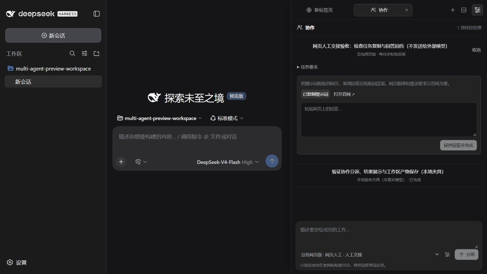

# 免费网页与本地模型

方案及接口核对日期：2026-10-26。本轮实现两条通道，共用现有“协作”标签、任务归属和产物目录。

截图为本机功能验收，未向网页模型发送测试任务；[完成后的结果](free-web-result.jpg)明确标注为测试者填写的文字。

| 通道 | 本轮接入 | 如何完成任务 |
| --- | --- | --- |
| 网页人工协作 | DeepSeek、豆包、Qwen、Kimi 的官方入口；可添加其他 HTTPS 网页 | DSH 分派 → 用户复制任务 → 在官网提问 → 粘贴回答 → 主任务取回结果 |
| 本地自动协作 | Ollama 等本机 OpenAI 兼容服务 | DSH 分派 → loopback API 执行 → 自动保存结果 |
| 有免费额度的云 API | 沿用已有兼容 API 配置入口 | 需要用户自己的账号、Key 和额度；本轮不自动注册或启用 |

DSH 主会话仍使用原来配置的模型与计费方式；这里新增的是协作资源，不会把主 agent 的 API 调用转换为免费网页调用。

## 网页怎么用

首次安装从资源目录添加网页成员，已有安装保留自己的成员配置。发布包不会携带开发者的成员或任务记录；Ollama 需配置实际模型后启用。

1. 右上角开关展开侧栏，点击标签栏 **＋ → 协作任务**。
2. 点击底部配置按钮，展开 **免费/本地资源**，选择 DeepSeek、豆包、Qwen 或 Kimi。
3. 检查官网地址和职责说明，保存成员。网页成员不需要 API Key，不保存网站 Cookie。
4. 在协作栏选择该成员、填写任务并分派；也可以让 DSH 主模型使用 `sidecar_submit_task` 分派。
5. 展开显示“等待你粘贴回答”的任务，点击 **复制提示词**、**打开官网**。自行登录，在官网粘贴并提交。
6. 把官网回答粘回该任务，点击 **保存回答并完成**。任务结果标注“用户粘贴”，并保存到当前主会话工作区。

复制权限不可用时会显示可选择的完整提示词。点击打开官网只访问网站地址，不把任务放进 URL，也不会自动提交输入内容。粘贴结果以纯文本保存，不执行其中的 HTML 或代码。

本轮网页回传支持文字。网页生成的图片需要用户从官网保存，尚未实现网页图片的自动下载或回传；现有 Images API 成员仍可自动生成并保存图片。

网页任务不占用 API 并发位置，关闭面板或重启服务后仍保留待办。等待工具遇到这类任务会立即返回 `requiresUserAction: true`，主模型应提示用户操作后暂停，而不是不断轮询。已取消或完成的任务不能再被另一份回答覆盖。完成回答的入口只向 UI 提供，没有给模型注册“替用户完成”的工具。

示例主任务：

> 列出可用协作成员，给豆包网页版分派“整理这段需求的疑问”，给 DeepSeek 网页版分派“审查边界情况”。遇到等待用户操作就告诉我到协作栏完成，我粘贴结果后再继续整合。

## 为什么官网在外部打开

当前 DSH Sidecar 运行在普通 Web 客户端里。网页登录涉及网站自己的浏览器存储、登录状态和嵌入策略，不能保证在沙箱 iframe 中完整工作。2026-10-26 无登录只读检查中，Qwen 明确返回 `X-Frame-Options: SAMEORIGIN` 及限制跨域的 `frame-ancestors`；DeepSeek 请求返回 403；豆包、Kimi 的该次响应没有禁止嵌入的头，但这不代表登录和全部功能已验证。

因此本版在 DSH 内管理任务、提示词和返回结果，在官网完成交互。未实现网页自动操作，也不使用私有聊天接口、网页登录凭据或修改网站的安全响应头来伪装 API。后续若提供官方自动化接口，可以再增加单独适配器。

## Ollama 怎么用

从资源列表选择 **Ollama 本地模型**，默认地址为 `http://127.0.0.1:11434/v1`。先自行安装并启动 Ollama、下载合适模型，再填入实际的模型名并启用成员。配置保存只验证字段，不证明服务在线或模型已安装。本轮未安装 Ollama，也未下载大型模型；本机暂未检测到其可执行程序或 11434 监听。

Ollama 的本地接口无需鉴权，并支持 OpenAI 兼容调用。[官方鉴权说明](https://docs.ollama.com/api/authentication) · [兼容接口](https://docs.ollama.com/api/openai-compatibility)

无密钥模式仅接受明确的本机回环地址，并且只支持文本 Chat Completions / Responses。此模式不读取已配置 Key 或环境变量，不发送 `Authorization`。远程网关仍需自己的鉴权配置。

“本地免费”指运行本机已下载模型不消耗供应商的推理 API 余额，仍使用电脑的内存、算力和电力。Ollama 也能转发云模型，因此不能仅凭地址是 localhost 就认为所有模型都免费；本地成员应选择本机模型，云模型需另行核对账号与费用。

## 免费范围与官方来源

| 资源 | 范围与入口 |
| --- | --- |
| DeepSeek 网页版 | [官网](https://www.deepseek.com/)链接到 [chat.deepseek.com](https://chat.deepseek.com/)。网页体验和开发者 API 是不同入口；不承诺 API 免费。 |
| 豆包网页版 | [官方入口](https://www.doubao.com/chat/)。免费功能、登录要求和次数以当前账号界面为准。 |
| Qwen 网页版 | [官方介绍](https://qwen.ai/qwenchat)、[官方聊天](https://chat.qwen.ai/)。网页权益不代表百炼 API 余额。 |
| Kimi 网页版 | [官方入口](https://www.kimi.com/)。免费档仍有模型和任务用量限制。 |
| 云 API 赠额 | 例如百炼新人额度有地域、模型和有效期限制；已认证账户可能在赠额用完后转为付费，可在平台设置“用完即停”。本插件不能替平台保证零扣费。[百炼规则](https://help.aliyun.com/zh/model-studio/new-free-quota/) |

登录、注册或领取赠额由用户在对应官网完成。本项目不会自动读取其他应用的账号，不自动开通付费服务，也不会将网页会员或 ChatGPT 订阅当作 API Key。

## 验证范围

代码验证使用本地夹具覆盖：无 Key 网页交接、无鉴权本机请求、不会后台请求官网、等待与取消、跨主会话隔离、重复回答拒绝、重启恢复和结果来源标记。真实网页模型推理、各账号的免费额度及本地模型性能需要用户具备相应登录或运行环境后再验证。最新实机步骤见 [VALIDATION.md](../VALIDATION.md)。
