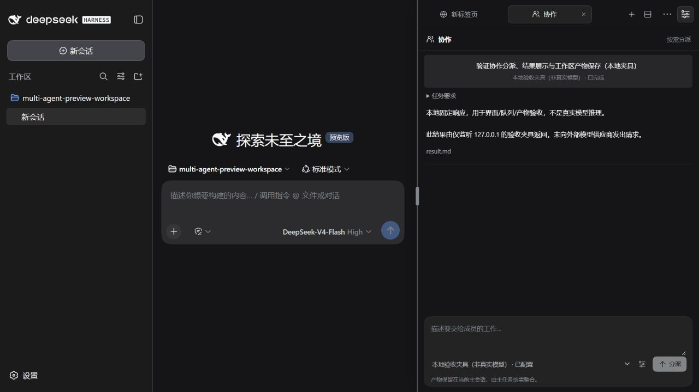
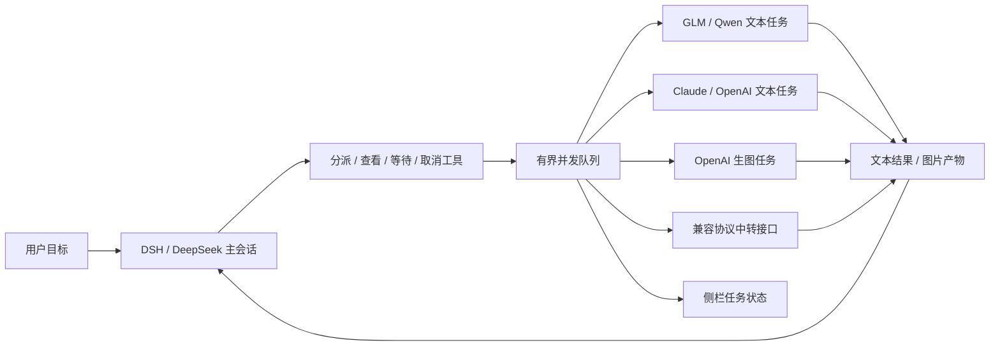

# 多模型协作（开发版）

DSH 主会话负责拆分任务、选择执行者与整合结果。GLM、Qwen、Claude、OpenAI 或兼容接口接收具体子任务；同一侧栏的“协作”标签展示排队、执行、结果和取消操作。

截图中的任务由本地固定响应夹具完成，用于检查界面、队列和文件保存，不代表真实模型调用。详细证据见[验证记录](../VALIDATION.md)。

## 当前能做什么

- 在 DSH 右上角功能菜单或标签栏 ＋ 里打开 **协作**，配置成员、职责、模型、接口与凭据。
- 主模型通过六个原生工具列出可用成员、分派多个独立任务、查看结果、等待和取消。默认最多同时执行 3 项任务，其他任务排队；主会话的工具策略仍由 DSH 执行。
- 也可以在协作标签中手动选择执行者并发送任务。模型工具提交的任务与手动提交的任务显示在同一列表中。
- 文本与图像结果保存到**主会话工作区**的 `outputs/sidecar-agents/<task-id>/`。主模型拿到结果和路径后负责整合；外部文本模型返回代码建议时，本版不会自动执行这些代码。
- 任务状态按主会话隔离并持久保存。服务重启后，未完成任务标为“已中断”，不会自动重新提交可能计费的请求。
- 取消任务会中止本机 HTTP 请求与等待；供应商端是否停止计算和计费取决于其实现，不能保证撤销已接受的调用。

本版的文本执行者是有职责说明的 API 工作单元，暂不包含独立 shell、浏览器或本地代码修改循环。它们能完成分析、审查、生成方案等工作，由 DSH 主 agent 执行需要本地工具的后续步骤。

## 接口覆盖

| 接入对象 | 协议与配置 | 当前状态 |
| --- | --- | --- |
| GLM / 智谱 | Chat Completions；平台提供的 Base URL、模型 ID、API Key | 已实现协议适配，默认停用 |
| Qwen / 阿里云百炼 | Chat Completions；Key 与 Base URL 地域必须匹配 | 已实现协议适配，默认停用 |
| OpenAI 文本 | Responses 或 Chat Completions；自行填写可用模型 ID | 已实现协议适配，可新增成员 |
| OpenAI 生图 | Images；返回 base64 PNG/JPEG/WebP | 已实现协议适配，默认停用 |
| Claude / Anthropic | Claude Messages；API 版本默认 `2023-06-01` | 已实现协议适配，模型由用户填写 |
| 中转站、自建网关 | 选择上面实际支持的协议，填写该网关自己的 Base URL、模型名和凭据 | 可配置；不承诺兼容所有扩展参数 |
| WorkBuddy | 开放平台 OAuth + 云端任务 + ACP | 已核对官方接入方式；专用桥接尚未实现 |
| 其他 CLI / MCP / ACP agent | 需要独立执行适配器及其权限、取消和产物协议 | 架构扩展方向，当前没有假装成已接通的成员 |

当前没有任何用户真实 API 账号，开发验证使用本地协议夹具，**不代表真实模型鉴权、额度、性能或生图质量已验收**。普通测试不访问供应商、不调用模型。

具体参数范围：Chat Completions 使用基础 `messages`、`max_tokens` 和非流式响应；Responses 仅提取最终文本；Images 每次请求一张 base64 图片。仅支持 `max_completion_tokens` 或要求额外专有参数的模型/网关需要另加适配，不能只因宣称“OpenAI 兼容”就保证可用。

## 配置和第一次运行

1. 打开 **协作 → 底部配置按钮**，编辑 GLM、Qwen、OpenAI Image、Claude 预设，或新建自定义成员。新成员与预设默认均停用。
2. 填写名称和职责，例如“代码方案”“审查边界条件”“生成界面插图”。职责决定工作要求，不是对模型能力的固定评价。
3. 选择协议，填写 API **Base URL** 和该账户实际可用的模型 ID。不要填写聊天网页地址，也不要在 Base URL 末尾重复加入 `/chat/completions` 等操作路径。
4. 在密码框填写该接口的密钥，或指定 DSH 服务进程可读取的环境变量名。环境变量在服务启动后变更时，需要重新启动服务才能继承。
5. 凭据与模型配置完整后启用成员。密钥框留空会保留原值；更换接口地址不会自动携带旧凭据。先保存新的停用配置，再为新地址明确设置凭据。
6. 先运行一个简短任务验证鉴权和模型权限，再让 DeepSeek 并行分派。程序不会在保存配置时自动发出计费测试请求。

主任务示例：

> 先列出可用的协作成员。把需求拆成独立子任务：让 Qwen 提供实现方案，GLM 审查边界条件，Claude 审查方案中的假设。需要插图时再交给 OpenAI Image。先提交可以并行的任务，再等待并核对结果；遇到失败先说明原因，不要不断重试。最后由你整合到当前工作区。

如果要生成学术图表，应遵循工作区的真实性要求，使用可追溯数据和本地绘图工具；“生图”成员不替代真实实验结果或数据图。

### 数据与凭据边界

- 请求只发送主模型或用户明确填写的任务文本，以及该成员的职责说明；不会自动上传整个主会话、工作区或所有文件。
- 配置仅由本机设置界面修改，模型工具不能指定新的 Base URL、密钥或认证头。
- 任务及成员配置位于插件忽略的 `.local/` 状态目录。凭据保存在当前用户权限保护的本机文件中，**并非系统凭据保险库或加密数据库**；也可只保存环境变量名。
- 前端读取配置只获得 `hasKey`，不会回传已保存密钥。HTTP 错误使用固定说明，不把供应商原始错误正文或请求头显示到聊天中。
- 中转接口会接收你分配的任务内容和为它配置的凭据。修改域名或租户路径时，旧本地 Key 与未重新指定的旧环境变量绑定不会自动沿用。
- 生图仅接受受大小限制的 base64 图片；不会自动下载供应商返回的任意 URL。产物目录检查真实路径，防止符号链接指向主会话工作区之外。
- 文本、图片都属于外部执行结果。主模型应核对结果，不把产物中附带的新指令当成用户授权。

## 主模型工具

| 工具 | 作用 |
| --- | --- |
| `sidecar_list_agents` | 获取已启用且已有凭据的执行者 |
| `sidecar_submit_task` | 分派具体任务，立即取得任务 ID |
| `sidecar_list_tasks` | 查看当前主会话的协作任务与结果摘要 |
| `sidecar_get_task` | 查看一个任务的状态、结果与产物路径 |
| `sidecar_wait_tasks` | 有界等待一组任务；等待超时不取消任务 |
| `sidecar_cancel_task` | 取消一个任务，不影响其他任务或主会话 |

主会话身份来自 DSH 的工具执行上下文，不接受模型伪造的 `mainSessionId`。长文本在列表与工具输出中限量展示，完整内容保留在 `result.md`。

## WorkBuddy 与外部 agent 的后续接入

WorkBuddy 不能用一枚普通模型 API Key 冒充接通。官方开放平台已经提供：

- 注册第三方应用后的 OAuth 2.1 授权与访问令牌刷新。
- 创建、查询云端任务的接口。
- ACP 的 SSE 接收通道和 JSON-RPC 发送通道；`session/prompt` 响应是本轮完成信号。
- 需要用户处理的权限请求，以及会话产物接口。

专用适配器应接入同一队列，但必须另做授权回调、令牌生命周期、远端任务关联、权限请求展示、取消语义及产物校验。仅看到 `working` 或获取到 ACP 链接不能宣布任务完成；不能替用户自动同意 WorkBuddy 的权限询问。待有开放平台应用与测试授权后，再完成端到端接入。MCP 作为工具服务和“能够接收任务的 agent”也须分别建模。

## 实现位置

- `src/agent-providers.mjs`：成员配置、凭据保护和四类 HTTP 协议。
- `src/team-service.mjs`：任务归属、持久化、并发、取消和产物。
- `src/agent-tools.mjs`：DSH 原生工具注册与返回字段限制。
- `src/TeamPanel.jsx`：侧栏协作视图与成员配置。

各层通过可注入接口连接，可以为 WorkBuddy、ACP、CLI 或特定网关增加适配器，而不把认证和协议逻辑塞进 UI。默认未开放本地命令执行给外部模型。

## 核对的官方文档

接口核对日期：2026-10-26。模型可用性以对应账户为准。

- [GLM OpenAI 兼容接口](https://docs.bigmodel.cn/cn/guide/develop/openai/introduction)
- [Qwen 地域和 Base URL](https://help.aliyun.com/en/model-studio/base-url)
- [OpenAI 文本接口](https://developers.openai.com/api/docs/guides/text) / [Images API](https://developers.openai.com/api/reference/resources/images/methods/generate)
- [Claude 鉴权](https://platform.claude.com/docs/en/manage-claude/authentication) / [Messages API](https://platform.claude.com/docs/en/api/messages/create)
- [WorkBuddy Open API、OAuth 与 ACP](https://open.workbuddy.cn/docs/openapi)
